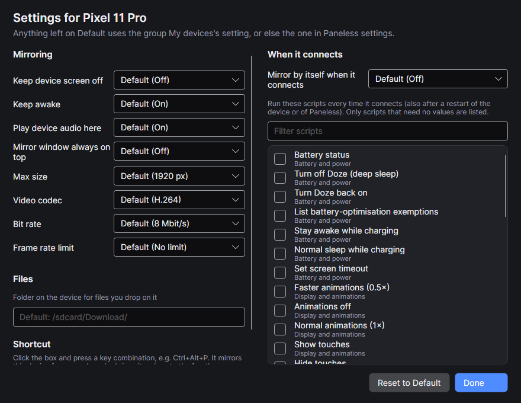

<p align="center">
  
</p>

<h1 align="center">Paneless</h1>

<p align="center">
  <a href="https://github.com/Stiviemain/paneless/releases"><b>⬇&nbsp;&nbsp;Download Paneless for Windows</b></a>
  &nbsp;·&nbsp; <a href="#install">How to install</a>
  &nbsp;·&nbsp; <a href="CHANGELOG.md">What's new</a>
  &nbsp;·&nbsp; <a href="#support-paneless">♥ Support</a>
</p>

<p align="center">
  <b>Painless screen mirroring and device management for your Android devices.</b><br>
  Finds the phones, tablets and watches on your Wi-Fi, mirrors any of them to your PC with one click,<br>
  and manages one device or a whole fleet at once: install apps, run scripts, change settings, control groups together.<br>
  Built on <a href="https://github.com/Genymobile/scrcpy">scrcpy</a>, with an interface made with <a href="https://avaloniaui.net/">Avalonia</a>.
</p>

<p align="center">
  <a href="https://github.com/Stiviemain/paneless/releases"></a>
  <a href="LICENSE"></a>
  
  
  <a href="https://avaloniaui.net/"></a>
</p>

<p align="center">
  
</p>

---

## Contents

- [Why Paneless](#why-paneless)
- [Features](#features)
- [Install](#install)
- [First use](#first-use)
- [Using Paneless](#using-paneless)
- [AI assistants](#ai-assistants)
- [Privacy and security](#privacy-and-security)
- [Troubleshooting](#troubleshooting)
- [Building from source](#building-from-source)
- [Support Paneless](#support-paneless)
- [Credits and license](#credits-and-license)

## Why Paneless

[scrcpy](https://github.com/Genymobile/scrcpy) is excellent, but it's a command-line tool: you have to find each device's address, pair it, connect it and remember the right options. Paneless does that for you, and goes beyond watching a screen:

- **See:** a live list of every device on your network, with status and battery, and their screens on your PC with a toolbar on every mirror.
- **Manage:** organise devices in groups, then act on one device or a whole group at once.
  - Install or remove apps.
  - Copy files.
  - Run adb scripts.
  - Apply settings.
- **Control:** use your keyboard and mouse on a device, map keys for games, or do something once and have it happen on every device of a group.
- **Automate:** set devices up with recipes, run tasks on a schedule, get alerts when a battery runs low or an app crashes, and run scripts every time a device connects (e.g. turn off Doze).
- **Ask an AI assistant:** let Claude, Codex, Gemini CLI or another MCP app answer questions about your devices or work on them for you, within the limits you set per device.

That makes it handy at home with a phone and a tablet, and just as useful with a shelf of test devices, kiosk tablets or a family's phones.

Everything runs locally between your PC and your devices. Paneless has no account, no cloud and no app on the phone.

The interface is built with [Avalonia](https://avaloniaui.net/), a cross-platform .NET UI framework. That keeps Paneless a fast, native desktop app (no browser engine inside) and lets the same code run on macOS and Linux later.

## Features

**Finding and organising devices**
- **Finds devices by itself** (wireless debugging over mDNS) and shows name, model, status, battery and address. The list refreshes every few seconds.
- **Pairs new devices** with the 6-digit code. The pairing address fills itself in.
- **Groups:** collapsible sections, *Mirror all*, and a group manager. Devices of a group that aren't around are still listed.
- **Search and natural sort** ("Lab phone 2" before "Lab phone 10") for long lists.
- **Connects known devices by itself** when they show up on the network.

**Mirroring**
- One click (or double-click, or Enter) to mirror one or many devices.
- Keep the device's own screen off while mirroring, keep it awake, play its audio on the PC, keep the window on top.
- **Settings per device or per group:** max size, video codec (H.264, H.265, AV1), bit rate and frame-rate limit.
- **Auto-unlock:** a saved PIN or password is entered when you mirror a locked device. Swipe patterns aren't supported.
- **Second screen:** a separate, resizable screen of the device next to its own.
- **Apps in their own window,** on a virtual display, so the device's screen is left alone.
- **Camera:** the back or front camera in a window. The picture follows how the phone is held.
- **Arrange windows:** tile all mirrors, or one group's, across the screen.

**Toolbar on every mirror**
- Rotate, back, home, recent apps, volume, power.
- Screen off, notifications, quick settings.
- Screenshot, record, camera, type the PC clipboard.
- **Key mapping** for games: keys become taps and a WASD or arrow-key joystick.
- **Group control:** what you do on one device happens on the whole group.

<p align="center">&nbsp;&nbsp;</p>

**Managing devices, one or a whole fleet**
- **Act on a group in one go:** drop an APK on a group heading to install it on every device in it; send files the same way; run a script on the whole group.
- **Scripts:** your own adb commands and about 45 built-in ones with explanations (battery and Doze, display, apps, network, device info, …), run on any devices or groups at once.
  - Per-device output.
  - Fields like `{package}` are asked for when a script runs.
  - Risky scripts ask first.
- **Run scripts automatically** every time a device connects, e.g. *Turn off Doze*, so settings that reset on restart stay the way you want.
- **App manager:** open, force-stop, disable, clear data, uninstall, install APKs (also on a whole group).
- **Settings per device or group:** mirror quality, behaviour on connect, a folder for files.
- **Group control:** do something on one device and it happens on every connected device of its group.

<p align="center"></p>

**Automation** (the *Automation* page)
- **Recipes:** a list of apps, files, scripts, commands and a restart that sets up a new or reset device in one go. Run one on the selected devices or a group, with progress per device.
- **Scheduled tasks:** run a script, a recipe, a restart or a command daily, weekly or every few hours, e.g. restart the lobby tablets every night.
- **Alerts:** a Windows notification when a battery runs low, storage gets full, a device gets hot, drops off the network, or an app crashes. Each alert fires once, not every minute.

**Overviews**
- **Wall:** a live picture of every device, refreshed every few seconds while the page is open. Click one to mirror it.
- **Logs:** the live log (logcat) of a device, filtered by importance, text or app, with crashes in red. Save it to a file.
- **Inventory:** model, Android version, security patch, battery, storage, RAM, address and uptime of every device. Export it as CSV for Excel or as an HTML report.

<p align="center"></p>
<p align="center"></p>

**AI assistants**
- Paneless can be a tool for Claude, Codex, Gemini CLI and other AI apps that support [MCP](https://modelcontextprotocol.io). Ask about your devices, or let the assistant install apps, run scripts or operate a screen. See [AI assistants](#ai-assistants).

**Around the app**
- Notification-area icon, optional start with Windows.
- A global shortcut per device (e.g. Ctrl+Alt+P).
- **Automatic updates** from GitHub Releases: downloaded in the background and installed when you close Paneless. Can be turned off.
- **Share scripts:** export one or all of your scripts as a file or to the clipboard; import from a file, the clipboard or a link (e.g. a GitHub Gist). Imported scripts are shown before they're added and ask before running.
- **Light and dark mode**, following the system theme by default and switching live in Settings.
- **English, German and French**, following Windows' language or chosen in Settings.

## Install

**Windows 10 or 11 (64-bit).** Download `Paneless-<version>-Setup.exe` from [Releases](https://github.com/Stiviemain/paneless/releases) and run it.

- Installs for your Windows user only, so it needs **no admin rights**.
- Includes everything it needs: .NET, scrcpy and adb. Nothing else to install.
- Adds Start menu and desktop shortcuts, and an entry under **Settings › Apps › Installed apps** to uninstall it.

There's also a portable zip if you don't want to install it.

> **Windows SmartScreen** may warn about an unknown publisher, because the installer isn't code-signed yet. Click *More info › Run anyway*, or check the SHA-256 checksum published with the release first.

macOS and Linux builds are planned: the code is already cross-platform thanks to Avalonia, but those builds aren't packaged or tested yet.

## First use

On each device, once:

1. **Settings › About phone**, tap **Build number** 7 times to unlock developer options.
2. **Settings › System › Developer options**, turn on **Wireless debugging**.
3. In Paneless, click **+ Add device › Pair with a code**. On the device, tap **Pair device with pairing code** and type the 6-digit code into Paneless.

From then on, the device appears whenever Wireless debugging is on and it's on the same Wi-Fi. Android 17 turns wireless debugging back on by itself on trusted networks.

## Using Paneless

| To… | Do this |
|---|---|
| Mirror a device | Double-click it, or select it and press **Mirror** / Enter |
| Mirror several | Ctrl- or Shift-click them, then **Mirror** |
| Mirror a whole group | **Mirror all** on the group's heading |
| Make or edit groups | **Groups…**, or right-click devices › **Move to group** |
| Change settings for one device | Right-click › **Device settings…** (a group: its ⋯ › **Group settings…**) |
| Run a command on devices | **Run script…** (on a group: its ⋯ menu) |
| Run something every time a device connects | **Device settings › When it connects** |
| Install an app | Drop the APK on a device or group, or **More › Apps…** |
| Turn the camera picture | It follows the phone; Alt+← / Alt+→ in the camera window turn it by hand |
| Repeat your taps on a group | Toolbar › **Group control** |
| Set up new devices the same way | **Automation › Recipes**, then **Run recipe** |
| Restart devices every night | **Automation › Scheduled tasks › + New** |
| Get told about low batteries or crashes | **Automation › Alerts** |
| See every screen at once | **Wall** |
| Find out why an app crashes | **Logs**, then **Crashes only** |
| Get a list of all devices for Excel | **Inventory › Read devices › Export** |
| Share a script | **Scripts**, select it, **Share** (to add one: **Import**) |
| Switch light / dark mode | **Settings › Appearance** (follows the system theme by default) |
| Change the language | **Settings › Language**, then restart Paneless |

<p align="center"></p>

**Where your data is** (Windows): `%LOCALAPPDATA%\Paneless`.
- `known-devices.json`, `settings.json`, `groups.json`, `profiles.json`, `scripts.json`, `keymaps.json`
- `recipes.json`, `schedules.json`, `alerts.json`
- `unlock-codes.json`, encrypted (see below)

Screenshots and recordings go to `Documents\Paneless`. Logs, including what AI assistants did, are in `%TEMP%\paneless`.

## AI assistants

Paneless can be a tool for AI assistants through [MCP](https://modelcontextprotocol.io), the open standard many AI apps use. Your assistant can then answer questions like *"Which of my devices have less than 20 % battery?"* or do things like *"Install this APK on the Test lab group"*.

Works with:

| App | How to connect |
|---|---|
| [Claude Desktop](https://claude.ai/download) | **Add to Claude Desktop**, then restart it |
| [Claude Code](https://claude.com/claude-code) | run the command shown once in a terminal |
| [Codex](https://developers.openai.com/codex) (CLI, editor extension, Codex in the ChatGPT desktop app) | **Add to Codex**, or run the command shown |
| [Gemini CLI](https://github.com/google-gemini/gemini-cli) | **Add to Gemini CLI**, then start a new session |
| Other MCP apps (Cursor, VS Code, LM Studio, …) | copy the settings shown into the app's MCP settings |

ChatGPT and Gemini in a web browser can't reach programs on your PC, so they can't use Paneless.

1. In Paneless, open the **AI** page and switch on **AI assistants may use Paneless**.
2. Pick your app under **Connect an assistant** and follow the step shown.
3. Decide what assistants may do, for all devices or per group and device:

| Level | Assistants may… |
|---|---|
| Nothing | not see the device at all |
| Read | see status, battery, apps and the log |
| See | also take screenshots |
| Control | also tap, swipe, type and open apps |
| Manage | also install and remove apps, copy files, run scripts, recipes and commands, restart |

By default assistants may only **read**, and Paneless asks you before one changes anything, naming the app that asks (*Allow once*, *Allow for 15 minutes* or *Don't allow*). **Pause** refuses everything until you resume, and the page lists what each assistant did. Paneless never gives an assistant your unlock codes.

<p align="center"></p>

Paneless has to be running (it starts in the notification area by itself when an assistant needs it). The connection stays on your PC: the AI app talks to Paneless through a local pipe only your Windows account can open.

## Privacy and security

- **Local only.** Paneless talks to your devices over your own network with adb and scrcpy. It sends nothing anywhere else, with two exceptions:
  - Update checks ask GitHub for the newest release (switch off in **Settings › Updates**).
  - If you connect an AI assistant, what it reads through Paneless (device facts, logs, screenshots) becomes part of your conversation with that AI service. Only the devices and levels you allow are visible to it.
- **Unlock codes** are encrypted with Windows DPAPI, the protection Credential Manager and browsers use. Only your Windows account on this PC can read them (on macOS the keychain, on Linux the Secret Service).
  - A code is typed only after Paneless confirms the device is locked and its lock screen is in front.
  - One failed try pauses auto-unlock for that device.
- **Wireless debugging** gives full control of a device to any computer you paired. Only pair computers you trust, and turn it off on networks you don't.
- Found a vulnerability? Please see [SECURITY.md](SECURITY.md).

## Troubleshooting

<details>
<summary><b>A device doesn't show up</b></summary>

- Wireless debugging must be on, and the device on the same network as the PC.
- Some routers and VPNs block local-network discovery (mDNS). Use **+ Add device › Connect by address** with the IP:port shown under Wireless debugging.
- After a reset of Wireless debugging, pair the device again.
</details>

<details>
<summary><b>"Allow on device" / unauthorized</b></summary>

Unlock the device and accept the debugging prompt ("Always allow from this computer").
</details>

<details>
<summary><b>The mirror is choppy</b></summary>

In **Settings** (or Device settings), lower *Max size* or *Bit rate*, or try *H.265*. 5 GHz Wi-Fi helps a lot.
</details>

<details>
<summary><b>The camera turns off when the phone rotates</b></summary>

Some phones (e.g. Pixels) cut a camera off when they rotate. Paneless reopens it by itself, turned to match, in the same place.
</details>

<details>
<summary><b>Where are the logs?</b></summary>

`%TEMP%\paneless`: one log per mirror window, `on-connect.log` for automatic scripts, and `errors.log` for unexpected errors. Please attach the relevant one to bug reports, after checking it for anything private.
</details>

## Building from source

Requirements: the [.NET 10 SDK](https://dotnet.microsoft.com/download) and Windows 10/11 for the installer.

```bash
git clone https://github.com/Stiviemain/paneless.git
```
```bash
dotnet run --project paneless/src/Paneless.App
```

For running from source, scrcpy must be installed, e.g. with `winget install Genymobile.scrcpy`. The installer build bundles it.

To build the installer: `powershell -File build.ps1`, which writes `releases\PanelessApp-win-Setup.exe`. Architecture, test flags and the release process are in [docs/DEVELOPMENT.md](docs/DEVELOPMENT.md). Contributions are welcome; see [CONTRIBUTING.md](CONTRIBUTING.md).

## Support Paneless

Paneless is free and open source, and stays that way. If it saves you time, you can support its development:

<p>
  <a href="https://ko-fi.com/Stiviemain"></a>
</p>

**[Ko-fi](https://ko-fi.com/Stiviemain):** a one-off "coffee" or a monthly membership, no account needed.

Not into donating? A ⭐ on the repo, a bug report or telling a friend helps just as much. The links are also in the app: the ♥ button in the main window, and *Settings › Support Paneless*. Paneless never asks by itself.

## Credits and license

Paneless is [MIT licensed](LICENSE). It stands on the shoulders of:
- [scrcpy](https://github.com/Genymobile/scrcpy) by Genymobile and Romain Vimont, which does the actual mirroring;
- Android's adb;
- [Avalonia](https://avaloniaui.net/), the UI framework every window is built with;
- [CommunityToolkit.Mvvm](https://github.com/CommunityToolkit/dotnet) and [Velopack](https://velopack.io) (installer and updates).

Their licenses are listed in [THIRD-PARTY-NOTICES.md](THIRD-PARTY-NOTICES.md).

Paneless isn't affiliated with Google, Genymobile, AvaloniaUI or any device maker. Android is a trademark of Google LLC.
