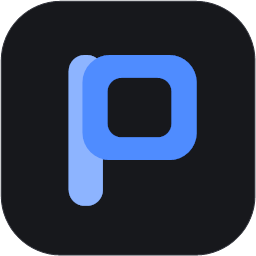
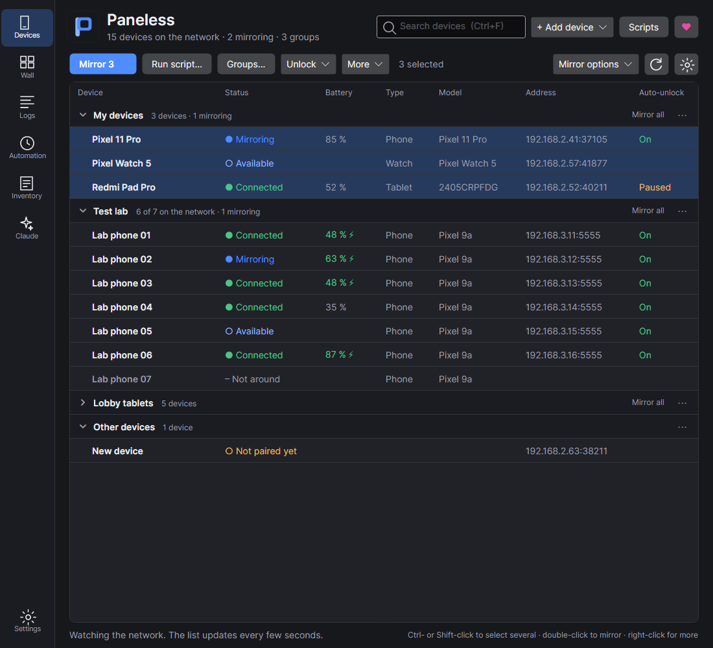
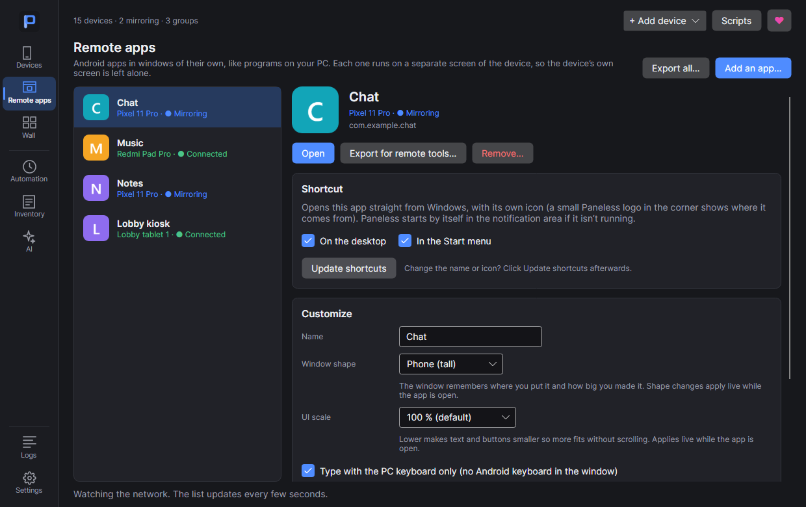
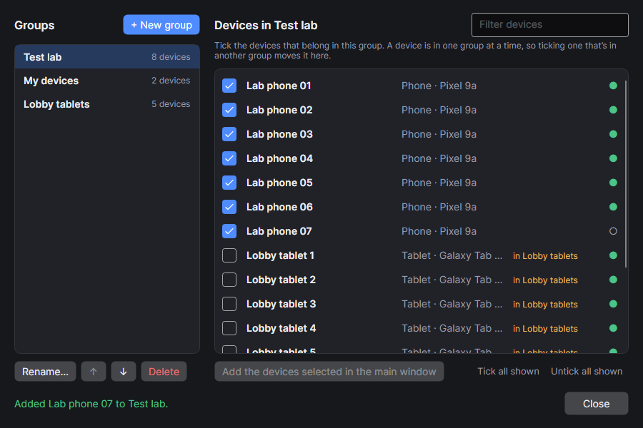
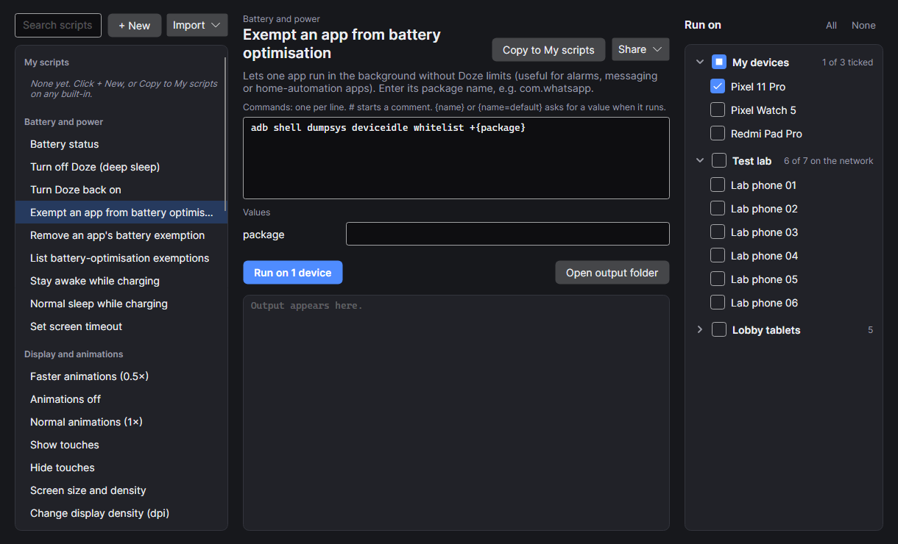
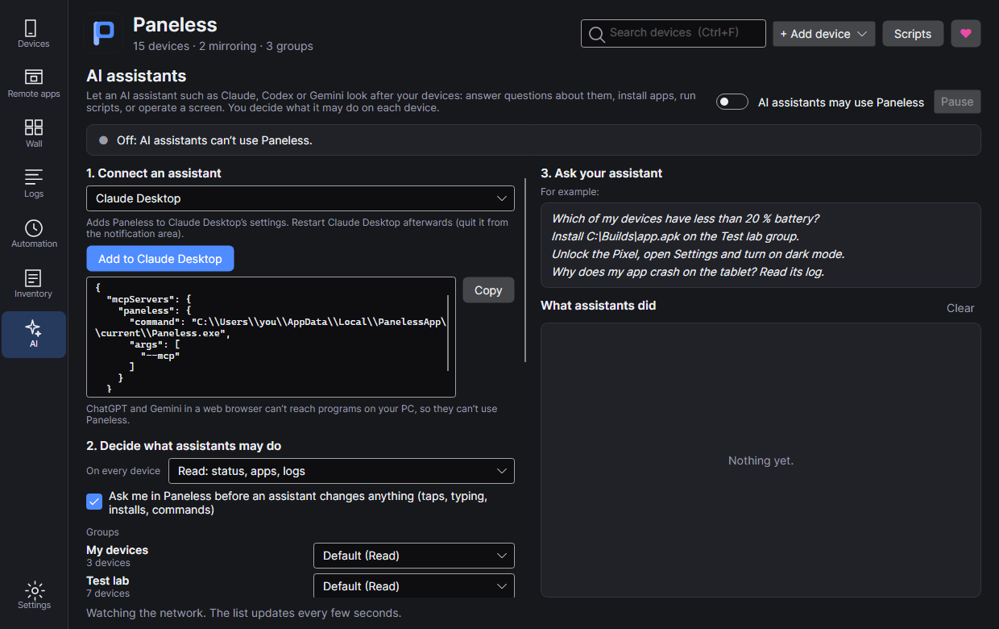
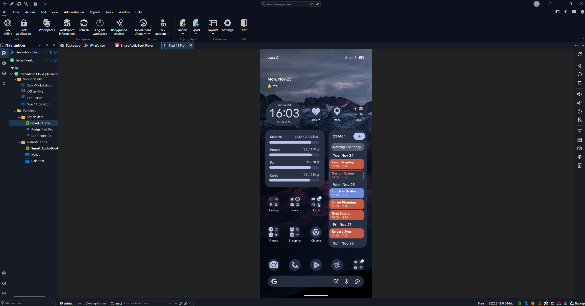

<p align="center">
  
</p>

<h1 align="center">Paneless</h1>

<p align="center">
  <a href="https://github.com/Stiviemain/paneless/releases"><b>⬇&nbsp;&nbsp;Download Paneless for Windows</b></a>
  &nbsp;·&nbsp; <a href="#install">How to install</a>
  &nbsp;·&nbsp; <a href="docs/GUIDE.md">User guide</a>
  &nbsp;·&nbsp; <a href="CHANGELOG.md">What's new</a>
  &nbsp;·&nbsp; <a href="#support-paneless">♥ Support</a>
</p>

<p align="center">
  <b>Painless screen mirroring, Remote apps, Phone-to-PC sync and device management for Android.</b><br>
  Connects phones, tablets and watches over Wi-Fi or USB, mirrors any screen with one click,<br>
  runs Android apps like native Windows programs with their own icons and shortcuts, syncs files, clipboard and quick controls,<br>
  and manages one device or a whole fleet — with <b>no Android app to install</b>.<br>
  Built on <a href="https://github.com/Genymobile/scrcpy">scrcpy</a>, with an interface made with <a href="https://avaloniaui.net/">Avalonia</a>.
</p>

<p align="center">
  <a href="https://github.com/Stiviemain/paneless/releases"></a>
  <a href="https://github.com/Stiviemain/paneless/actions/workflows/build.yml"></a>
  <a href="LICENSE"></a>
  
  
  <a href="https://avaloniaui.net/"></a>
</p>

<p align="center">
  
</p>

---

## Contents

- [Install](#install)
- [Remote apps](#remote-apps)
- [Highlights](#highlights)
- [Remote tools (RDM)](#remote-tools-rdm)
- [AI assistants](#ai-assistants)
- [Privacy and security](#privacy-and-security)
- [Troubleshooting](#troubleshooting)
- [Building from source](#building-from-source)
- [Support Paneless & License](#support-paneless)

## Install

**Windows 10 or 11 (64-bit).** Download `Paneless-<version>-Setup.exe` (or the portable zip) from [Releases](https://github.com/Stiviemain/paneless/releases) and run it—no admin rights required. Everything is bundled (.NET, `scrcpy`, `adb`), and updates arrive automatically from GitHub Releases (can be disabled in Settings).

> **Windows SmartScreen** may warn about an unknown publisher while the installer is unsigned. Click *More info › Run anyway*. All release binaries are built publicly by [GitHub Actions](https://github.com/Stiviemain/paneless/actions/workflows/release.yml) with SHA-256 checksums and [build provenance attestations](https://github.com/Stiviemain/paneless/attestations) attached—or you can [build from source](#building-from-source) in two commands.

*macOS and Linux builds are planned (the UI is cross-platform Avalonia, not packaged yet).*

**First use:** enable **Developer options** (tap *Build number* 7×), then plug in via **USB debugging** (right-click › **Device utilities › Switch to Wi-Fi** afterwards to cut the cord) or pair over **Wireless debugging** with **+ Add device › Pair with a code**. See [First use & the full User Guide](docs/GUIDE.md#first-use).

## Remote apps

Run any Android app in its own resizable Windows window—complete with its real app icon, taskbar button, and optional desktop/Start menu shortcuts—while your phone stays locked and its screen stays off.

<p align="center"></p>

- **Virtual display isolation:** leaves the phone's own screen untouched (right-click inside the window goes back).
- **Native taskbar identity & shortcuts:** windows and pinned shortcuts carry the app's real icon (shortcuts add a tiny Paneless corner badge) and wake Paneless on demand even if the IP changed.
- **Remembers size, shape & live scale:** switch between Phone, Tablet, or Custom window shapes and **UI scale** (`65 %`–`150 %`) live while the app is open.
- **PC keyboard & auto-unlock:** suppresses Android's on-screen keyboard by default and unlocks automatically when a PIN is saved.
- **Stays live while locked:** keeps virtual app windows active after the physical screen turns off (*Keep app windows on when locked*, on by default).

*Android limits: apps that block capture (e.g. banking) render black, an app can only run in one display at a time, and Android provides device-wide rather than per-app audio.* See [User Guide › Remote apps](docs/GUIDE.md#remote-apps).

## Highlights

Paneless turns [scrcpy](https://github.com/Genymobile/scrcpy) and `adb` into a fast, native [Avalonia](https://avaloniaui.net/) desktop app that runs **100 % locally** between your PC and your Android devices—no cloud, no account, and **no Android app to install**.

- **Mirroring & toolbar:** automatic mDNS Wi-Fi + USB discovery, one-click mirrors, keep device screen off, DPAPI-encrypted auto-unlock, audio on PC, second screens, back/front camera windows, key mapping, group control, and a toolbar + `⋯` tools menu on every mirror.
- **Phone-to-PC sync (zero phone app):** EXIF-aware **Files & photos** browser with drag-and-drop upload and auto-download of new photos/screenshots, **always-on two-way clipboard sync**, **Quick controls & media** (Dark mode, DND, Auto-brightness, live brightness/volume sliders, Now Playing), **Locate device**, and opt-in **2FA / OTP auto-copy** (EN, DE, FR).
- **Fleet management & automation:** organise devices into collapsible groups, drag APKs or files onto a group, run ~45 built-in or shared `adb` scripts (or auto-run *On connect*), batch-provision with **Recipes**, set **Scheduled tasks**, and get Windows **Alerts** on low battery, heat, storage, drops, or crashes.
- **Live Wall, Logs & Inventory:** watch all device screens in a customizable **Wall** (with smart wake/unlock and *Show mirror* for screen-off mirrors), filter live `logcat` crashes in **Logs**, and export device hardware/patch sheets as CSV or HTML in **Inventory**.
- **Desktop-first & battery-friendly:** pauses/slows background polling in the tray, shuts down its idle helper automatically, disconnects idle Wi-Fi devices after 5 min in the tray to preserve Android Deep Doze, includes Settings backup/reset, global hotkeys, `Ctrl+1`–`Ctrl+7` / `Ctrl+,` navigation, Light/Dark themes, and English / German / French.

<p align="center"></p>

<details>
<summary><b>More screenshots (toolbar, groups, scripts, automation, device settings, AI)</b></summary>

<p align="center">&nbsp;&nbsp;</p>
<p align="center"></p>
<p align="center"></p>
<p align="center"></p>
<p align="center"></p>

</details>

Need step-by-step instructions? Read the **[29-action cheat sheet, feature reference, and data paths in the User Guide](docs/GUIDE.md#using-paneless)**.

## Remote tools (RDM)

Open Android mirrors and Remote apps as native tabs alongside RDP, SSH, and VPN sessions inside [Devolutions Remote Desktop Manager](https://devolutions.net/remote-desktop-manager/) (RDM)—with no plugin required.

<p align="center"></p>

- **True embedded tabs:** mirrors and Remote apps dock cleanly inside RDM tabs on Windows and close with the tab, complete with a compact inline mirror toolbar.
- **Vault organization & icons:** Paneless groups become RDM folders with real app icons, centered Remote app shapes, and stable IDs for duplicate-free re-imports.

Export one device, a whole group, or Remote apps via **Export for remote tools…** and import the `.rdm` file in RDM. See [User Guide › Remote tools (RDM)](docs/GUIDE.md#remote-tools-rdm).

## AI assistants

Connect Paneless as a local [MCP](https://modelcontextprotocol.io) server so your assistant can inspect battery/logs/screens or operate devices with explicit per-device permissions.

| App | How to connect |
|---|---|
| [Claude Desktop](https://claude.ai/download) | **Add to Claude Desktop**, then restart it |
| [Claude Code](https://claude.com/claude-code) | run the command shown once in a terminal (`claude mcp list` verifies) |
| [Codex](https://developers.openai.com/codex) (CLI, IDE extension, ChatGPT app) | **Add to Codex**, or run the command shown |
| [Gemini CLI](https://github.com/google-gemini/gemini-cli) | **Add to Gemini CLI**, then start a new session (`/mcp` lists Paneless) |
| [Cursor](https://cursor.com) | **Add to Cursor** (writes `~/.cursor/mcp.json`), then reload MCP servers |
| Other MCP apps (VS Code, LM Studio, …) | copy the settings shown (in VS Code, `Ctrl+Shift+P` › **MCP: Add Server**) |

*(Web-only ChatGPT/Gemini in a browser cannot reach local desktop apps.)* Permissions scale per device or group from **Nothing** → **Read** *(default)* → **See** *(screenshots & redacted `read_ui_tree`)* → **Control** → **Manage**, with interactive confirmation prompts (*Allow once*, *Allow for 15 minutes*, *Don't allow*) and an instant **Pause** switch. Unlock codes are never exposed, and clients connect over a user-scoped local named pipe. See [User Guide › AI assistants](docs/GUIDE.md#ai-assistants-mcp) for the full permission matrix and examples.

<details>
<summary><b>Manual MCP configuration (stdio)</b></summary>

```json
{
  "mcpServers": {
    "paneless": {
      "command": "C:\\Users\\<you>\\AppData\\Local\\PanelessApp\\current\\Paneless.exe",
      "args": ["--mcp"]
    }
  }
}
```

</details>

## Privacy and security

- **Local only:** all communication uses `adb`, `scrcpy`, and Paneless's temporary in-RAM `/data/local/tmp` helper (`paneless-helper`, auto-stops when idle, zero wakelocks, no APK). The only external connections are optional GitHub update checks and whatever data you allow an AI assistant to read into your chat session.
- **Unlock codes:** encrypted with Windows DPAPI (`SecretVault`), typed only when a lock screen is confirmed, paused after one failed attempt, never exported in Settings backups, and never revealed to AI assistants.
- **Wireless debugging:** grants full device control to paired PCs—only pair trusted machines. Found a vulnerability? See [SECURITY.md](SECURITY.md).

## Troubleshooting

<details>
<summary><b>A device doesn't show up</b></summary>

- Wireless debugging must be on, and the device on the same network as the PC.
- Some routers and VPNs block local discovery (mDNS). Use **+ Add device › Connect by address** with the `IP:port` shown under Wireless debugging.
- After toggling Wireless debugging reset/re-pair, pair the device again.

</details>

<details>
<summary><b>"Allow on device" / unauthorized</b></summary>

Unlock the device and accept the debugging prompt ("Always allow from this computer").

</details>

<details>
<summary><b>The mirror is choppy</b></summary>

In **Settings** (or **Device settings**), lower *Max size* or *Bit rate*, or try *H.265*. 5 GHz Wi-Fi helps significantly.

</details>

<details>
<summary><b>The camera turns off when the phone rotates</b></summary>

Some phones (e.g. Pixels) stop the camera stream on rotation. Paneless automatically reopens it in the same window rotated to match.

</details>

<details>
<summary><b>Where are the logs?</b></summary>

`%TEMP%\paneless`: per-mirror logs, `on-connect.log`, `assistant-activity.log`, and `errors.log`. Check for sensitive details before attaching to bug reports.

</details>

## Building from source

Requires the [.NET 10 SDK](https://dotnet.microsoft.com/download) (plus `scrcpy` installed locally when running from source, e.g. `winget install Genymobile.scrcpy`; the installer bundles it):

```bash
git clone https://github.com/Stiviemain/paneless.git
dotnet run --project paneless/src/Paneless.App
```

Build the Windows installer (`releases\PanelessApp-win-Setup.exe`) with `powershell -File build.ps1`. See [docs/DEVELOPMENT.md](docs/DEVELOPMENT.md) for architecture/test flags and [CONTRIBUTING.md](CONTRIBUTING.md) to contribute.

## Support Paneless

Paneless is free and open source. If it saves you time, you can support development on **[Ko-fi](https://ko-fi.com/Stiviemain)**—or simply leave a ⭐ on the repo, file a bug report, or share it with a colleague.

<p>
  <a href="https://ko-fi.com/Stiviemain"></a>
</p>

## Credits and license

Paneless is [MIT licensed](LICENSE) and built on [scrcpy](https://github.com/Genymobile/scrcpy), Android `adb`, [Avalonia](https://avaloniaui.net/), [CommunityToolkit.Mvvm](https://github.com/CommunityToolkit/dotnet), and [Velopack](https://velopack.io) (see [THIRD-PARTY-NOTICES.md](THIRD-PARTY-NOTICES.md)). Not affiliated with Google, Genymobile, AvaloniaUI, Devolutions, or any device manufacturer; Android is a trademark of Google LLC.
