# Paneless User Guide

Detailed setup, quick-action cheat sheet, full feature reference, Remote apps, Devolutions RDM export, and AI assistant (MCP) configuration for [Paneless](../README.md).

## Contents

- [First use](#first-use)
- [Using Paneless](#using-paneless)
- [Where your data is](#where-your-data-is)
- [Feature reference](#feature-reference)
  - [Finding and organising devices](#finding-and-organising-devices)
  - [Mirroring](#mirroring)
  - [Toolbar on every mirror](#toolbar-on-every-mirror)
  - [Phone-to-PC tools](#phone-to-pc-tools)
  - [Managing devices, one or a whole fleet](#managing-devices-one-or-a-whole-fleet)
  - [Automation](#automation)
  - [Overviews](#overviews)
  - [Around the app](#around-the-app)
- [Remote apps](#remote-apps)
- [Remote tools (RDM)](#remote-tools-rdm)
- [AI assistants (MCP)](#ai-assistants-mcp)

---

## First use

On each device, once:

1. Open **Settings › About phone** and tap **Build number** 7 times to unlock developer options.
2. Choose how you want to connect:
   - **Over USB (Android 5+):** under **Settings › System › Developer options**, turn on **USB debugging**, plug the device into your PC, and tap **Allow** on the prompt. You can also right-click the device › **Device utilities › Switch to Wi-Fi** to unplug the cable afterwards (also works on Android 10 and older).
   - **Over Wi-Fi (Android 11+):** under **Developer options**, turn on **Wireless debugging**, then in Paneless click **+ Add device › Pair with a code**, tap **Pair device with pairing code** on the device, and enter the 6-digit code.

From then on, plugged-in USB devices appear immediately, and paired Wi-Fi devices appear whenever Wireless debugging is on on the same Wi-Fi. Android 17 turns wireless debugging back on by itself on trusted networks.

## Using Paneless

| To… | Do this |
|---|---|
| Mirror a device | Double-click it, or select it and press **Mirror** / Enter |
| Mirror several | Ctrl- or Shift-click them, then **Mirror** |
| Mirror a whole group | **Mirror all** on the group's heading |
| Unplug a USB device and keep mirroring | Right-click › **Device utilities › Switch to Wi-Fi** (or **More › Device utilities › Switch to Wi-Fi**) |
| Make or edit groups | **Groups…**, or right-click devices › **Move to group** |
| Change settings for one device | Right-click (or row `⋯`) › **Device settings…** (a group: its `⋯` › **Group settings…**) |
| Run a command on devices | **Tools › Run a script…** (on a group: its `⋯` menu › **Run a script on this group…**) |
| Run something every time a device connects | **Device settings › On connect** |
| Install an app | Drop the APK on a device or group, or **Tools › Apps…** |
| Turn the camera picture | It follows the phone; `Alt+←` / `Alt+→` in the camera window turn it by hand |
| Repeat your taps on a group | Toolbar › **⋯ › Group control** |
| Set up new devices the same way | **Automation › Recipes**, then **Run recipe** |
| Restart devices every night | **Automation › Scheduled tasks › + New** |
| Get told about low batteries or crashes | **Automation › Alerts** |
| Use an Android app like a PC program | **Remote apps › Add an app…**, then **Open** or **Create shortcut** |
| Open devices or Remote apps as tabs in RDM | Right-click a device / group (or on **Remote apps**) › **Export for remote tools…** |
| Browse files and photos on a device | Right-click › **Files & photos…** (or **Tools › Files & photos…**) |
| Toggle Dark mode, DND, Auto-brightness, volume or media | Right-click › **Quick controls & media…** (or **Tools › Quick controls & media…**) |
| Sync clipboard, photos or 2FA codes | **Device settings › Sync & files** (or **Group settings…**), pick the sync options you want |
| Pop the phone's current app into a PC window | Right-click › **Displays & camera › Pop out current app** (or toolbar › **⋯**) |
| Ring & flash a misplaced phone | Right-click › **Device utilities › Locate device** (also on the **Wall**) |
| See every screen at once | **Wall** |
| Find out why an app crashes | **Logs** (at the bottom of the left bar), then **Crashes only** |
| Get a list of all devices for Excel | **Inventory › Read devices › Export** |
| Share a script | **Scripts**, select it, **Share** (to add one: **Import**) |
| Back up or reset Paneless settings | **Settings › Updates & backup** |
| Switch pages with the keyboard | `Ctrl+1`–`Ctrl+7` for pages, `Ctrl+,` for **Settings** |
| Switch light / dark mode | **Settings › General** (follows the system theme by default) |
| Change the language | **Settings › General**, then restart Paneless |

<p align="center">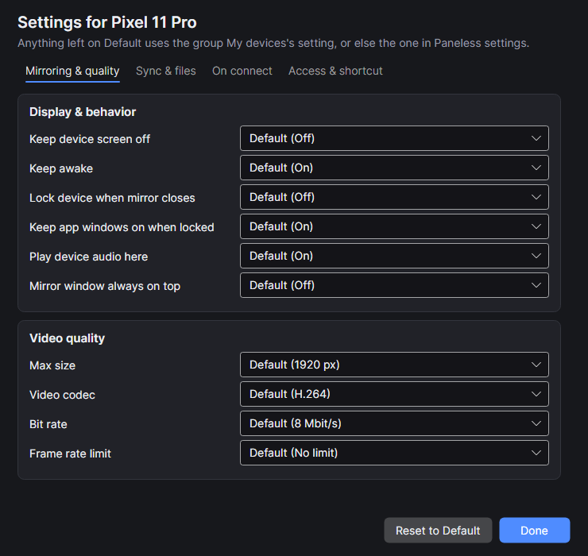</p>

## Where your data is

On Windows, configuration lives in `%LOCALAPPDATA%\Paneless`:

- `known-devices.json`, `settings.json`, `groups.json`, `profiles.json`, `scripts.json`, `keymaps.json`
- `recipes.json`, `schedules.json`, `alerts.json`
- `remote-apps.json`, and the apps' icons in `remote-apps\`
- `unlock-codes.json`, encrypted with Windows DPAPI

Screenshots and recordings go to `Documents\Paneless`. Auto-downloaded device photos and screenshots go to `Documents\Paneless\Media\<Device>`. Logs, including what AI assistants did (`assistant-activity.log`), `on-connect.log`, `errors.log`, and per-mirror logs, are in `%TEMP%\paneless`.

---

## Feature reference

### Finding and organising devices

- **Works over Wi-Fi and USB:** finds wireless devices automatically (mDNS) and picks up USB-connected devices as soon as you plug them in. Right-click any USB device › **Device utilities › Switch to Wi-Fi** to cut the cord (also works on Android 10 and older).
- **Pairs new Wi-Fi devices** with the 6-digit code. The pairing address fills itself in.
- **Groups:** collapsible sections, *Mirror all*, and a group manager. Devices of a group that aren't around are still listed.
- **Search and natural sort** ("Lab phone 2" before "Lab phone 10") for long lists.
- **Connects known devices by itself** when they show up on the network.

### Mirroring

- One click (or double-click, or Enter) to mirror one or many devices.
- Keep the device's own screen off while mirroring, keep it awake, optionally lock it when the last mirror closes, play its audio on the PC, keep the window on top.
- **Settings per device or per group:** max size, video codec (H.264, H.265, AV1), bit rate and frame-rate limit.
- **Auto-unlock:** a saved PIN or password is entered when you mirror a locked device. Swipe patterns aren't supported.
- **Second screen:** a separate, resizable screen of the device next to its own.
- **Apps in their own window,** on a virtual display, so the device's screen is left alone.
- **Camera:** the back or front camera in a window. The picture follows how the phone is held.
- **Arrange windows:** tile all mirrors, or one group's, across the screen.

### Toolbar on every mirror

- Quick-access strip: Back, Home, Recent apps, Volume, Power, Screen off, Rotate (or *Send back to device*), Screenshot, and Record.
- **`⋯` More tools menu:** Notifications, Quick settings, Type clipboard text, Second screen, Pop out current app, Back camera, Quick controls & media, Scripts, **Key mapping** (WASD / arrow joystick + tap keys for games), and **Group control** (what you do on one device happens on the whole group). Active live modes also appear directly on the strip for one-click toggle-off.

<p align="center">&nbsp;&nbsp;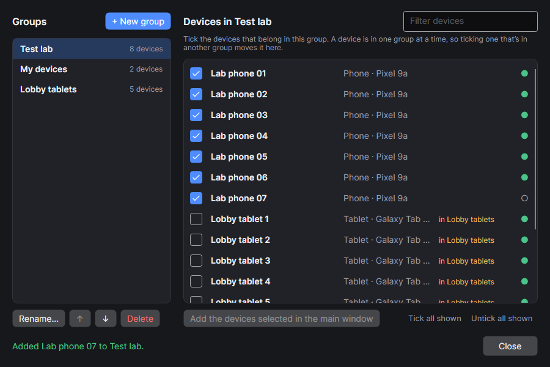</p>

### Phone-to-PC tools

Zero Android app installed:

- **Files & photos browser:** browse folders with EXIF-aware photo and video thumbnails, drag and drop files directly to upload (or download with a double-click), and optionally auto-download new photos and screenshots straight to `Documents\Paneless\Media\<Device>`.
- **Always-on clipboard sync** *(opt-in per device or group)*: instant two-way text clipboard sync between Windows and Android without mirroring open.
- **Quick controls & media:** toggle Dark mode, Do Not Disturb, Auto-rotate, Auto-brightness, Wi-Fi and Bluetooth, adjust live brightness and volume sliders, and control Now Playing media.
- **Locate device:** blink the flashlight, vibrate and chime a misplaced device from the Devices or Wall menu.
- **Opt-in 2FA / OTP auto-copy:** copies incoming verification codes from Android notifications straight to your Windows clipboard (EN, DE, FR).

<p align="center">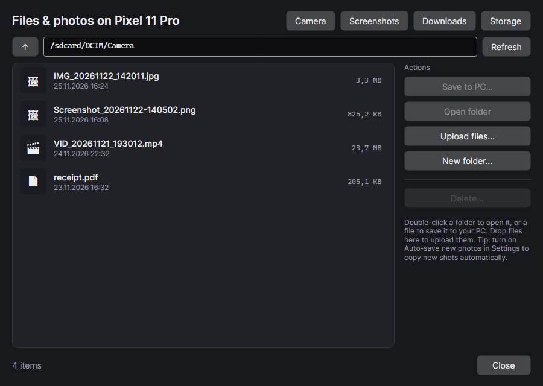&nbsp;&nbsp;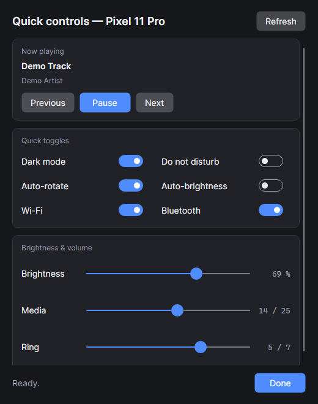</p>

### Managing devices, one or a whole fleet

- **Act on a group in one go:** drop an APK on a group heading to install it on every device in it; send files the same way; run a script on the whole group.
- **Scripts:** your own adb commands and about 45 built-in ones with explanations (battery and Doze, display, apps, network, device info, …), run on any devices or groups at once:
  - Per-device output.
  - Fields like `{package}` are asked for when a script runs.
  - Risky scripts ask first.
- **Run scripts automatically** every time a device connects, e.g. *Turn off Doze*, so settings that reset on restart stay the way you want.
- **App manager:** friendly app names with real icons, version and APK size; open, force-stop, disable, clear data, uninstall, install APKs (also on a whole group), or add straight to Remote apps.
- **Settings per device or group:** mirror quality, behaviour on connect, sync options, a folder for files.
- **Group control:** do something on one device and it happens on every connected device of its group.

<p align="center">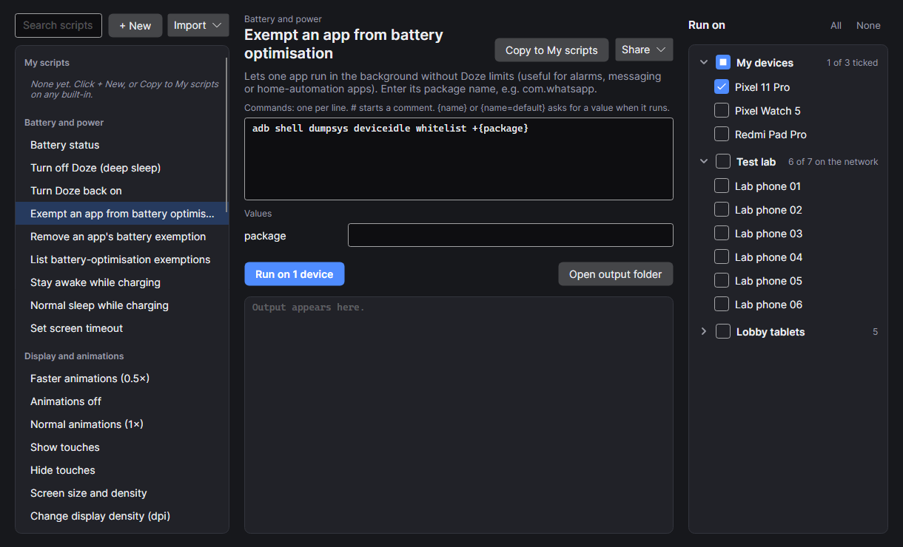</p>

### Automation

- **Recipes:** a list of apps, files, scripts, commands and a restart that sets up a new or reset device in one go. Run one on the selected devices or a group, with progress per device.
- **Scheduled tasks:** run a script, a recipe, a restart or a command daily, weekly or every few hours, e.g. restart the lobby tablets every night.
- **Alerts:** a Windows notification when a battery runs low, storage gets full, a device gets hot, drops off the network, or an app crashes. Each alert fires once, not every minute.

<p align="center">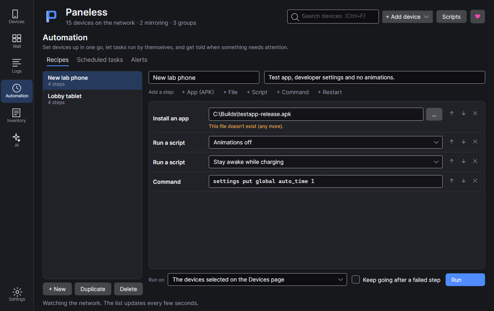</p>

### Overviews

- **Wall:** a live picture of every device, refreshed every few seconds while the page is open. Click one to mirror it, drag pictures into your own order, drag a picture's corner to resize it (or make them all one size), and right-click for more: wake or unlock the screen, save a screenshot, open a second screen, apps, files or quick controls, or hide a device. Sleeping screens show a **Wake** (or **Wake & unlock** / **Wake all**) button instead of a black picture, while actively mirrored screen-off devices offer **Show mirror** without waking the physical display.
- **Logs:** the live log (logcat) of a device, filtered by importance, text or app, with crashes in red. Save it to a file.
- **Inventory:** model, Android version, security patch, battery, storage, RAM, address and uptime of every device. Export it as CSV for Excel or as an HTML report.

<p align="center">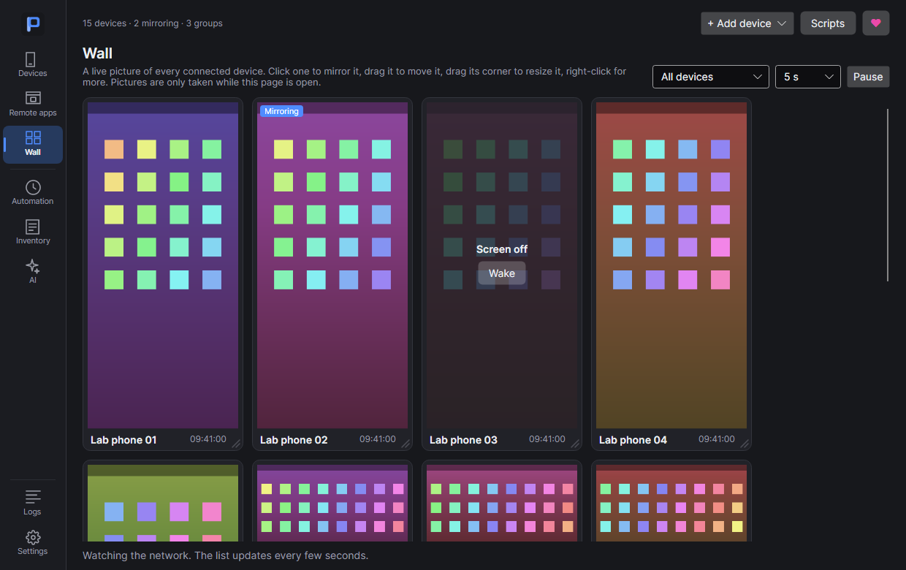</p>
<p align="center">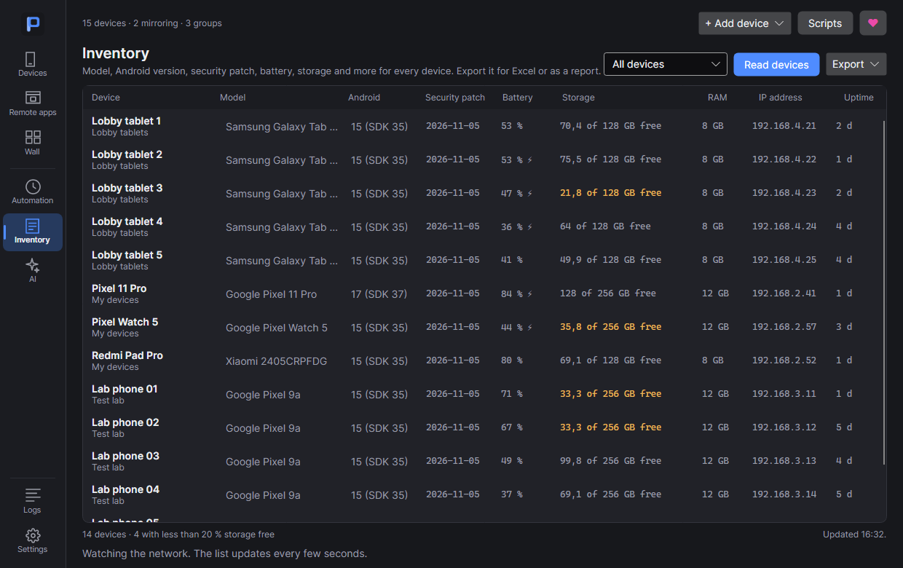</p>

### Around the app

- Notification-area icon, optional start with Windows, and keyboard navigation (`Ctrl+1`–`Ctrl+7` for pages, `Ctrl+,` for Settings).
- A global shortcut per device (e.g. `Ctrl+Alt+P`).
- **Battery-friendly in the background:** slows and pauses battery polling when minimized, shuts down its idle device helper automatically, and disconnects idle Wi-Fi devices after 5 minutes in the tray so phones stay in Android Deep Doze (reconnecting automatically when you open Paneless or launch a shortcut).
- **Settings backup & factory reset:** export and import your configuration (optionally including saved devices, groups, profiles and remote apps — unlock codes are never exported) or reset to defaults in **Settings**.
- **Automatic updates** from GitHub Releases: downloaded in the background and installed when you close Paneless. Can be turned off.
- **Share scripts:** export one or all of your scripts as a file or to the clipboard; import from a file, the clipboard or a link (e.g. a GitHub Gist). Imported scripts are shown before they're added and ask before running.
- **Light and dark mode**, following the system theme by default and switching live in Settings.
- **English, German and French**, following Windows' language or chosen in Settings.

---

## Remote apps

Use Android apps like programs on your PC, the way Windows' RemoteApp works over Remote Desktop: each app opens in a window of its own, without the rest of the phone around it.

<p align="center">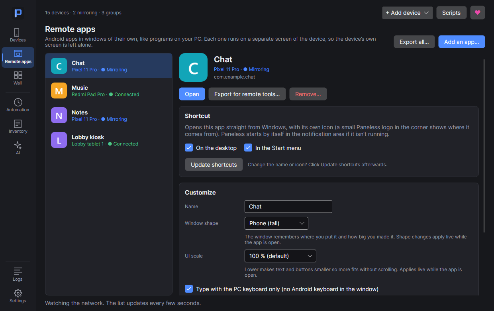</p>

1. Open the **Remote apps** page and click **Add an app…** (or, in a device's app manager, **Add to Remote apps**).
2. Pick the device and the app. Paneless reads the app's name and its real icon from the device.
3. Click **Open**, or double-click it. Click **Create shortcut** for one on the desktop and in the Start menu.

- **One window per app.** It runs on a separate virtual screen of the device, so the device's own screen is left alone (and can stay off). Right-click in the window goes back.
- **Looks like the app:** the window and its taskbar button have the app's name and icon. Pin it to the taskbar like any program.
- **Shortcuts** use the app's icon with a small Paneless logo in the corner, so you can tell where they come from. They start Paneless by itself (in the notification area) if it isn't running, and keep working when the device's IP address changes or Paneless updates.
- **Remembers its window:** size and place, per app. Choose a phone or tablet shape, or your own size — **Window shape** and **UI scale** (`65 %`–`150 %`) apply live while the app is open.
- **PC keyboard only:** Android's on-screen keyboard stays out of the window (can be switched off per app).
- The device is unlocked first if you saved its PIN.
- **Keeps showing when you lock the device:** the app window stays live while the device is locked and its own screen is off (*Settings › Mirroring & quality › Keep app windows on when locked*, on by default). Without it, some devices (e.g. Pixels with Android 17) turn the window black a few seconds after their screen goes off.

What Android doesn't allow: apps that block screen capture (banking, some video apps) show a black window, an app can only be open in one place at a time (opening it on the PC takes it off the phone's screen), and there's no sound per app. A few apps don't like a second screen and jump back to the phone.

App icons, Files & photos, Quick controls, clipboard sync, fast Wall captures and semantic UI trees are powered by a small helper (`paneless-helper`) that Paneless pushes to `/data/local/tmp` and runs over a local ADB socket (just like scrcpy's own server). It installs no Android app, holds no wakelocks, and shuts itself down automatically after 2 minutes idle (60 s on watches) whenever no background sync watcher or open tool window needs it.

## Remote tools (RDM)

Open your Android mirrors and Remote apps right alongside your RDP, SSH and VPN sessions inside connection managers like [Devolutions Remote Desktop Manager](https://devolutions.net/remote-desktop-manager/) (RDM)—no plugin or add-on required.

<p align="center">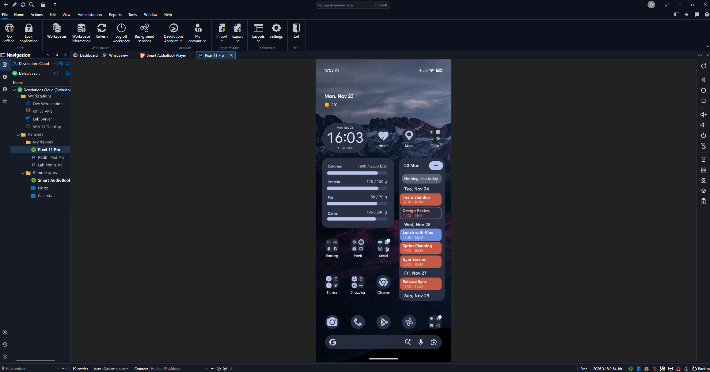</p>

1. In Paneless, pick what you want to export:
   - **A device or selection:** right-click › **Export for remote tools…** (or **More › Export for remote tools…**).
   - **A whole group:** group menu (`⋯` or right-click) › **Export for remote tools…** (includes offline group members too).
   - **Remote apps:** **Export for remote tools…** on one app, or **Export all…** in the page header.
2. Choose the target tool (**Remote Desktop Manager**), whether sessions open as an **Embedded tab** or an **External window**, and the vault folder (default `Paneless`), then save the `.rdm` file.
3. In RDM, import it via **File › Import › Import (.rdm)**.

- **True embedded tabs (Windows):** devices and Remote apps dock directly inside RDM tabs with no extra terminal window, and closing the tab closes the session cleanly.
- **Inline mirror toolbar:** embedded device mirrors include a compact right-hand toolbar inside the tab (Navigation, Volume/Power/Screen off, Rotate/Screenshot/Record, plus **`⋯`** for Notifications, Quick settings, and Type clipboard).
- **Real icons & folder structure:** Remote apps keep their real Android icon with the Paneless corner badge, mirrors get the Paneless icon, and your Paneless groups become vault folders.
- **Preserves your configured shape:** embedded Remote apps keep their phone, tablet or custom shape centered inside the tab instead of stretching across wide monitors.
- **Re-import friendly:** every entry gets a stable ID, so exporting again later updates existing entries in place instead of creating duplicates.

## AI assistants (MCP)

Paneless can be a tool for AI assistants through [MCP](https://modelcontextprotocol.io), the open standard many AI apps use. Your assistant can then answer questions like *"Which of my devices have less than 20 % battery?"* or do things like *"Install this APK on the Test lab group"*.

Works with:

| App | How to connect |
|---|---|
| [Claude Desktop](https://claude.ai/download) | **Add to Claude Desktop**, then restart it |
| [Claude Code](https://claude.com/claude-code) | run the command shown once in a terminal (`claude mcp list` verifies) |
| [Codex](https://developers.openai.com/codex) (CLI, editor extension, Codex in the ChatGPT desktop app) | **Add to Codex**, or run the command shown |
| [Gemini CLI](https://github.com/google-gemini/gemini-cli) | **Add to Gemini CLI**, then start a new session (`/mcp` lists Paneless) |
| [Cursor](https://cursor.com) | **Add to Cursor** (writes `~/.cursor/mcp.json`), then reload MCP servers |
| Other MCP apps (VS Code, LM Studio, …) | copy the settings shown (in VS Code, use `Ctrl+Shift+P` › **MCP: Add Server**) |

ChatGPT and Gemini in a web browser can't reach programs on your PC, so they can't use Paneless.

1. In Paneless, open the **AI** page and switch on **AI assistants may use Paneless**.
2. Pick your app under **Connect an assistant** and follow the step shown. *(If you use the portable zip, keep the folder in one place—its path is saved in your AI app's config.)*
3. Decide what assistants may do, for all devices or per group and device:

| Level | Assistants may… |
|---|---|
| Nothing | not see the device at all |
| Read | see status, battery, apps, remote apps, running apps, files list, clipboard, controls/media state and the log |
| See | also take screenshots and inspect the semantic UI tree (`read_ui_tree`, with password fields redacted) |
| Control | also tap/swipe/type, act on UI elements by label (`ui_action`), open apps / remote apps / URLs, hand off apps between displays, set clipboard, toggle quick controls/media, locate device, and unlock/lock using your saved code (never revealed to the assistant) |
| Manage | also install and remove apps, pull/copy files, run scripts, recipes and commands, restart |

By default assistants may only **read**, and Paneless asks you before one changes anything, naming the app that asks (*Allow once*, *Allow for 15 minutes* or *Don't allow*). **Pause** refuses everything until you resume, and the page lists what each assistant did. Paneless never gives an assistant your unlock codes, and marks every tool with standard MCP `readOnlyHint` / `destructiveHint` annotations.

**What you can ask:**
- *"Which of my devices have less than 20 % battery?"*
- *"Unlock the Pixel, open Settings and turn on dark mode, then lock it again."*
- *"Install `C:\Builds\app.apk` on the Test lab group."*
- *"Ring my Pixel so I can find it, or pull the latest screenshot from `DCIM/Screenshots`."*
- *"Why does my app crash on the tablet? Read its log."*

<details>
<summary><b>Manual MCP configuration (stdio)</b></summary>

Paneless runs as a standard local `stdio` MCP server (`Paneless.exe --mcp`). Most MCP clients accept:

```json
{
  "mcpServers": {
    "paneless": {
      "command": "C:\\Users\\<you>\\AppData\\Local\\PanelessApp\\current\\Paneless.exe",
      "args": ["--mcp"]
    }
  }
}
```

</details>

<p align="center">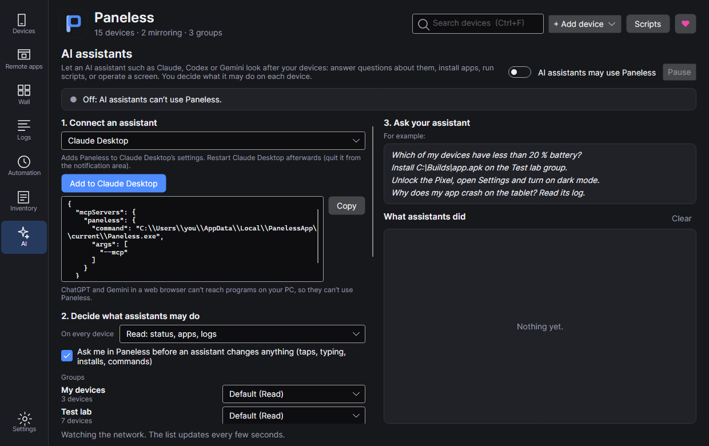</p>

Paneless has to be running (it starts in the notification area by itself when an assistant needs it). The connection stays on your PC: the AI app talks to Paneless through a local pipe only your Windows account can open.
